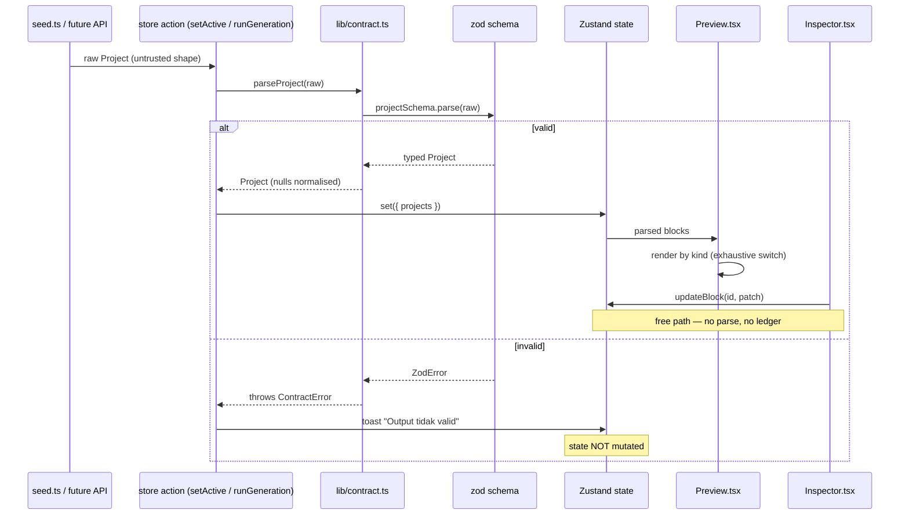

# Blueprint: mvp-foundation — Implementation

**Status:** Draft · **Date:** 2026-11-16 · **Implements:** `what.md` (rev. 2026-11-16)

---

## 1. Overview

Build the component contract — one whitelist array, one Zod schema derived from it, one
parse boundary — then delete the three dead block kinds and make `Preview.tsx` consume
validated types. Add Vitest so the contract is testable in Node without a browser.

### Key Design Decisions

- **The array is the schema's source, not its mirror.** `WHITELISTED_KINDS` is declared
  once; the Zod `kind` enum is `z.enum(WHITELISTED_KINDS)` and the TypeScript `BlockKind`
  type is `(typeof WHITELISTED_KINDS)[number]`. Everything else derives. AC-1.2 demands
  that a union member missing from the array be a build failure — that is only achievable
  if the union *is* the array. A hand-written union beside a hand-written array can drift
  silently, and drift is exactly the failure this blueprint exists to prevent.

- **Parse once at the store boundary; renderers take types.** Every renderer in
  `Preview.tsx` already accepts `block: UIBlock`. If parsing happened inside `ScreenView`,
  the inspector would re-validate the entire project on every keystroke through
  `updateBlock`. Parsing at the boundary means renderers need no changes to their
  signatures, and the inspector stays free and instant.

- **`.nullish()` plus normalisation, not `.optional()`.** `null` and `undefined` are
  different in JSON but both mean "no value" here. Accepting both at the schema and
  normalising to `undefined` on the way out means renderers branch on one absent case
  instead of two — otherwise `{block.title ?? ''}` is correct for `undefined` but renders
  the literal string `"null"` for `null`. This was the O-1/O-4/edge-case decision set.

- **`accent` is a discriminated concern, not a universal field.** Only `StatBlock` reacts
  to it. A schema permitting `accent` on `navbar` would let the inspector offer a control
  that does nothing there. Scoping it to `stat` makes the contract honest; widening later
  is additive and non-breaking.

- **Reject loudly, all-or-nothing.** A malformed payload fails the whole parse and surfaces
  a toast. Partial salvage would hide model misbehaviour precisely during early LLM
  tuning, when that visibility is worth more than resilience.

---

## 2. Architecture



---

## 3. Components and Interfaces

### 3.1 Existing Code to Reuse

| What | File Path | How to Reuse |
|------|-----------|--------------|
| `UIBlock`, `BlockKind` types | `apps/editor/src/lib/types.ts:34` | `BlockKind` is replaced by a derivation from the new array; `UIBlock` is inferred from the schema |
| `Screen`, `Project`, `Table`, `Column` types | `apps/editor/src/lib/types.ts:20-64` | Re-declared as Zod schemas; existing interfaces kept as the hand-written contract they must match |
| Accent vocabulary (`default`/`warn`/`action`/`ok`) | `apps/editor/src/components/inspector/Inspector.tsx:4` | Import `ACCENTS` ids into the schema; single source for the accent enum |
| `ScreenView` mapper | `apps/editor/src/components/preview/Preview.tsx:70` | Becomes an exhaustive switch; no signature change |
| `ring()` selection helper | `apps/editor/src/components/preview/Preview.tsx:124` | Unchanged; reused by every renderer |
| `StatBlock` accent handling | `apps/editor/src/components/preview/Preview.tsx:157` | Extended to cover `action`/`ok` (M-5) |
| Seed data | `apps/editor/src/lib/seed.ts` | Becomes test fixture; must pass the new schema unchanged |
| Toast shape | `apps/editor/src/store/useBuilder.ts:7` | Reused for the invalid-output toast; no new UI needed |
| `uid()` generator | `apps/editor/src/store/useBuilder.ts:17` | Reused where a parsed block needs an id fallback — not needed if `id` stays required |
| Timeout pattern (`AbortController`) | `scripts/sync-confluence.mjs` | Reference only; no network in this blueprint |

---

### 3.2 `apps/editor/src/lib/contract.ts` — the whitelist and schema

Full implementation. This is the file the system prompt will later read.

```ts
import { z } from 'zod'

/**
 * The one authoritative list of component kinds the model may emit.
 *
 * Everything else derives from this array:
 *   - `BlockKind` (TypeScript) is `(typeof WHITELISTED_KINDS)[number]`
 *   - the Zod `kind` enum is `z.enum(WHITELISTED_KINDS)`
 *   - the renderer switch in Preview.tsx must handle every member or fail to compile
 *
 * Adding a kind therefore means one edit here plus a renderer branch plus seed data —
 * and the compiler refuses the change until all three exist. Nothing may re-list these
 * literals elsewhere; that is what makes the whitelist a whitelist.
 */
export const WHITELISTED_KINDS = ['navbar', 'stat', 'table'] as const

export type BlockKind = (typeof WHITELISTED_KINDS)[number]

/**
 * Accent values, derived from the inspector's own palette so the two cannot drift.
 * Kept as a literal here rather than imported from a component, because `lib/` must not
 * depend on `components/` — the direction of that import is enforced by review, not the
 * compiler, so keep the list short and obvious.
 */
export const ACCENT_VALUES = ['warn', 'action', 'ok'] as const
export type Accent = (typeof ACCENT_VALUES)[number]

/**
 * Kinds that render `accent`. Only `StatBlock` reacts to it today (Preview.tsx:168).
 * An `accent` on any other kind is rejected rather than silently ignored: a schema that
 * accepts an inert field teaches the UI to offer controls that do nothing.
 */
const ACCENT_KINDS = new Set<BlockKind>(['stat'])

/** Enforced caps, so a pathological payload cannot freeze the tab. */
export const LIMITS = {
  maxScreens: 40,
  maxBlocksPerScreen: 200,
  maxTitleLength: 120,
  maxBodyLength: 2_000,
  maxIdLength: 64,
} as const

/**
 * Identifier rule. Deliberately loose enough for ULIDs, slugs and `b-` prefixed seed ids,
 * but no whitespace and no angle brackets — an id is a key, never content.
 */
const idSchema = z
  .string()
  .min(1, 'id must not be empty')
  .max(LIMITS.maxIdLength, `id must be at most ${LIMITS.maxIdLength} characters`)
  .regex(/^[A-Za-z0-9_.:-]+$/, 'id may only contain letters, digits, and . _ : -')

/**
 * Optional text. `.nullish()` accepts both `null` and absent; the transform normalises
 * `null` to `undefined` so renderers only ever branch on one absent case.
 *
 * Without this, `{block.title ?? ''}` renders the literal string "null" for a JSON null —
 * a bug that looks like a data-entry mistake to a user and like nothing at all in review.
 */
const optionalText = (max: number) =>
  z
    .string()
    .max(max, `text must be at most ${max} characters`)
    .nullish()
    .transform((v) => v ?? undefined)

/**
 * One UI block.
 *
 * `.passthrough()` is intentionally NOT used: unknown keys are stripped. A model that
 * emits `{ kind: 'stat', html: '<b>x</b>' }` gets `html` dropped, so a future renderer
 * cannot be tricked into reading it.
 */
const blockSchema = z
  .object({
    id: idSchema,
    kind: z.enum(WHITELISTED_KINDS),
    title: optionalText(LIMITS.maxTitleLength),
    body: optionalText(LIMITS.maxBodyLength),
    accent: z.enum(ACCENT_VALUES).nullish().transform((v) => v ?? undefined),
  })
  .superRefine((block, ctx) => {
    if (block.accent !== undefined && !ACCENT_KINDS.has(block.kind)) {
      ctx.addIssue({
        code: z.ZodIssueCode.custom,
        path: ['accent'],
        message: `accent is not supported on kind "${block.kind}"`,
      })
    }
  })

export const uiBlockSchema = blockSchema

export const screenSchema = z.object({
  id: idSchema,
  name: z.string().min(1).max(LIMITS.maxTitleLength).default('Layar'),
  blocks: z
    .array(blockSchema)
    .max(LIMITS.maxBlocksPerScreen)
    .superRefine((blocks, ctx) => {
      const seen = new Set<string>()
      for (const [i, b] of blocks.entries()) {
        if (seen.has(b.id)) {
          ctx.addIssue({
            code: z.ZodIssueCode.custom,
            path: [i, 'id'],
            // Duplicate ids corrupt React keys silently; fail here, not in the console.
            message: `duplicate block id "${b.id}" within screen`,
          })
        }
        seen.add(b.id)
      }
    }),
})

export const columnSchema = z.object({
  name: idSchema,
  type: z.enum(['INTEGER', 'TEXT', 'REAL', 'BOOLEAN']),
  primary: z.boolean().optional(),
  nullable: z.boolean().optional(),
  note: optionalText(LIMITS.maxTitleLength),
})

export const tableSchema = z.object({
  name: idSchema,
  columns: z.array(columnSchema).max(64),
  rows: z.number().int().nonnegative(),
})

export const projectSchema = z.object({
  id: idSchema,
  name: z.string().min(1).max(LIMITS.maxTitleLength),
  slug: z.string().min(1).max(LIMITS.maxTitleLength),
  prompt: z.string().max(LIMITS.maxBodyLength).default(''),
  tables: z.array(tableSchema).max(64).default([]),
  screens: z.array(screenSchema).max(LIMITS.maxScreens).default([]),
  tablesCount: z.number().int().nonnegative().default(0),
  screensCount: z.number().int().nonnegative().default(0),
  status: z.enum(['draft', 'live']).default('draft'),
  updatedAt: z.string().default('baru saja'),
})

/** Inferred types — the schema is the definition, the interface is its shadow. */
export type ParsedUIBlock = z.infer<typeof uiBlockSchema>
export type ParsedScreen = z.infer<typeof screenSchema>
export type ParsedProject = z.infer<typeof projectSchema>
```

---

### 3.3 `apps/editor/src/lib/parse.ts` — the parse boundary

Separated from `contract.ts` so the future orchestrator client can import one without the
other, and so tests can target the error surface independently.

```ts
import { z } from 'zod'
import { projectSchema, type ParsedProject } from './contract'

/**
 * A validation failure that carries enough context for a user-facing message but never
 * the whole payload. Quoting the offending value is useful; quoting a user's business data
 * into a toast or a log is not.
 */
export class ContractError extends Error {
  readonly code = 'INVALID_SCHEMA' as const
  readonly issues: { path: string; message: string }[]

  constructor(issues: { path: string; message: string }[]) {
    const first = issues[0]
    super(first ? `${first.path}: ${first.message}` : 'Payload tidak valid')
    this.name = 'ContractError'
    this.issues = issues
  }
}

/** Truncate a value quoted in an error so a 2,000-character body cannot flood a toast. */
const quote = (value: unknown): string => {
  const s = typeof value === 'string' ? value : JSON.stringify(value)
  if (s === undefined) return 'undefined'
  return s.length > 40 ? `${s.slice(0, 40)}…` : s
}

function toIssues(error: z.ZodError): { path: string; message: string }[] {
  return error.issues.map((issue) => ({
    path: issue.path.length ? issue.path.join('.') : '(root)',
    message: issue.message,
  }))
}

/**
 * Parse one project. Throws `ContractError`; never returns a partially valid value.
 *
 * All-or-nothing is deliberate: dropping bad blocks would hide model misbehaviour during
 * early tuning, which is exactly when it is worth seeing.
 */
export function parseProject(raw: unknown): ParsedProject {
  if (raw === null || raw === undefined) {
    throw new ContractError([{ path: '(root)', message: 'payload is null or undefined' }])
  }
  if (typeof raw !== 'object' || Array.isArray(raw)) {
    throw new ContractError([{ path: '(root)', message: `expected an object, got ${quote(raw)}` }])
  }
  const result = projectSchema.safeParse(raw)
  if (!result.success) throw new ContractError(toIssues(result.error))
  return result.data
}

/** Parse a list of projects. One failure fails the list — see the note above. */
export function parseProjects(raw: unknown): ParsedProject[] {
  if (!Array.isArray(raw)) {
    throw new ContractError([{ path: '(root)', message: `expected an array, got ${quote(raw)}` }])
  }
  const result = z.array(projectSchema).safeParse(raw)
  if (!result.success) throw new ContractError(toIssues(result.error))
  return result.data
}

/** Escape hatch for the seed, which is trusted code rather than model output. */
export function parseProjectsOrThrowAtStartup(raw: unknown): ParsedProject[] {
  try {
    return parseProjects(raw)
  } catch (error) {
    // Seed data is authored in this repo; a failure here is a coding error, not user input.
    // Surface it loudly during development instead of degrading to an empty app.
    const detail = error instanceof ContractError ? error.message : String(error)
    throw new Error(`Seed data violates the block contract: ${detail}`)
  }
}
```

---

### 3.4 `apps/editor/src/lib/types.ts` — narrowed to the contract

The interface declarations are replaced by inferences, so a change to the schema propagates
to every consumer. `COIN_COST`, `PIPELINE`, and `StageState` are untouched.

```ts
import type { ParsedProject, ParsedScreen, ParsedUIBlock, BlockKind } from './contract'

export type { BlockKind }

export const COIN_COST = {
  generate: 20,
  revise: 5,
  manualEdit: 0,
  publish: 50,
} as const

export type PipelineStage = 'prompt' | 'schema' | 'ui' | 'edit' | 'publish'

export const PIPELINE: { id: PipelineStage; label: string }[] = [
  { id: 'prompt', label: 'Prompt' },
  { id: 'schema', label: 'Skema' },
  { id: 'ui', label: 'UI' },
  { id: 'edit', label: 'Edit' },
  { id: 'publish', label: 'Terbit' },
]

export type StageState = 'done' | 'active' | 'pending'

/**
 * Structural types now come from the schema. `UIBlock`, `Screen`, `Project`, `Table` and
 * `Column` keep their names so the 18 files importing them need no edits, but they are
 * aliases rather than independent declarations — one definition, not two.
 */
export type UIBlock = ParsedUIBlock
export type Screen = ParsedScreen
export type Project = ParsedProject

export interface LedgerEntry {
  id: string
  at: string
  label: string
  detail: string
  coins: number
  outcome: 'spent' | 'free' | 'refunded' | 'failed'
  refId: string
}
```

> **Note on `Table` and `Column`:** they are re-exported from `contract.ts` in the same way
> (`export type Table = z.infer<typeof tableSchema>`), keeping `SchemaView.tsx` compiling
> without changes.

---

### 3.5 `apps/editor/src/store/useBuilder.ts` — parse at the boundary

Only the parts that change. `SEED_PROJECTS` is parsed once at module load via
`parseProjectsOrThrowAtStartup`, and `activeProject()` stays a selector, not a parser.

```ts
import { create } from 'zustand'
import { COIN_COST, type LedgerEntry, type Project } from '../lib/types'
import { SEED_LEDGER, SEED_PROJECTS, STARTER_BALANCE } from '../lib/seed'
import { parseProjectsOrThrowAtStartup } from '../lib/parse'

const STARTER_BALANCE_BASE = STARTER_BALANCE - SEED_LEDGER.reduce((s, e) => s + e.coins, 0)

const now = () =>
  new Date().toLocaleTimeString('id-ID', { hour: '2-digit', minute: '2-digit' })

const balanceOf = (ledger: LedgerEntry[]) =>
  ledger.reduce((sum, e) => sum + e.coins, STARTER_BALANCE_BASE)

/**
 * Seed data is parsed exactly once, at module load. It is authored in this repo, so a
 * failure is a coding error and throws rather than degrading to an empty app.
 * This is the only place `projects` enters state from an untrusted-or-authored source;
 * `updateBlock` mutates an already-parsed tree and must not re-parse it.
 */
const INITIAL_PROJECTS = parseProjectsOrThrowAtStartup(SEED_PROJECTS)
```

The store's `projects` field becomes `Project[]` where `Project` is the inferred type. The
`updateBlock` action is unchanged except that its patch type narrows:

```ts
  updateBlock: (
    blockId: string,
    patch: { title?: string; body?: string; accent?: 'warn' | 'action' | 'ok' | undefined },
  ) => void
```

No parse is added to `updateBlock` — that path is the free editor and must stay instant
(Q-3). The patch values originate from bounded inputs (`<input maxLength>`), and a stricter
check here would cost a keystroke of latency for no safety gain.

---

### 3.6 `apps/editor/src/components/preview/Preview.tsx` — exhaustive switch

`ScreenView` becomes an exhaustive switch so that adding a whitelisted kind without a
renderer is a compile error (AC-4.2). The `nav`/`stats`/`rest` partitioning stays because
it encodes layout, not kind handling.

```tsx
/**
 * Maps a block to its renderer. Exhaustive by construction: the `never` assignment at the
 * end makes a newly whitelisted kind a compile error until it has a branch here.
 */
function renderBlock(
  block: UIBlock,
  inspectOpen: boolean,
  selected: boolean,
  onSelect: (id: string) => void,
) {
  switch (block.kind) {
    case 'navbar':
      return <NavBlock block={block} inspectOpen={inspectOpen} selected={selected} onSelect={onSelect} />
    case 'stat':
      return <StatBlock block={block} inspectOpen={inspectOpen} selected={selected} onSelect={onSelect} />
    case 'table':
      return <TableBlock block={block} inspectOpen={inspectOpen} selected={selected} onSelect={onSelect} />
    default: {
      const unreachable: never = block.kind
      throw new Error(`Unhandled block kind: ${String(unreachable)}`)
    }
  }
}
```

`ScreenView` keeps its layout partitions and calls `renderBlock` for `rest`. An explicit
empty state is added (AC-3.2):

```tsx
{rest.length === 0 && stats.length === 0 && !nav && (
  <p className="py-10 text-center text-meta text-ink-meta">Layar ini belum memiliki blok.</p>
)}
```

`StatBlock` is extended for M-5 — the accent map replaces the single `warn` boolean:

```tsx
const ACCENT_CLASS: Record<'warn' | 'action' | 'ok', string> = {
  warn: 'text-warn-ink',
  action: 'text-action',
  ok: 'text-ok-ink',
}

function StatBlock({ block, inspectOpen, selected, onSelect }: StatBlockProps) {
  // `accent` is only typed on `stat`, and `undefined` means the default ink colour.
  const accentClass = block.accent ? ACCENT_CLASS[block.accent] : 'text-ink'
  return (
    <div
      onClick={() => inspectOpen && onSelect(block.id)}
      className={`border border-rule p-2.5 ${ring(inspectOpen, selected)}`}
    >
      <div className="text-[11.5px] font-medium text-ink-meta">{block.title}</div>
      <div className={`tnum mt-0.5 font-mono text-[21px] font-bold tracking-[-0.02em] ${accentClass}`}>
        {block.body}
      </div>
    </div>
  )
}
```

> **Type note:** `accent` is only permitted on `stat` by the schema, but `UIBlock` is a
> single inferred type covering all kinds — TypeScript cannot narrow `block.accent` by
> `block.kind` without a discriminated union. M-5 keeps the field optional-inferred and
> relies on the schema to reject it elsewhere; a discriminated union is the cleaner form and
> is noted as an improvement in `now.md`, not a blocker here.

---

### 3.7 `apps/editor/package.json` and test config

```jsonc
{
  "dependencies": {
    "react": "^18.3.1",
    "react-dom": "^18.3.1",
    "zod": "^3.23.8",
    "zustand": "^4.5.5"
  },
  "devDependencies": {
    "vitest": "^2.1.8"
    // …existing devDependencies unchanged
  },
  "scripts": {
    "dev": "vite",
    "build": "tsc --noEmit && vite build",
    "preview": "vite preview",
    "test": "vitest run",
    "test:watch": "vitest"
  }
}
```

`vite.config.ts` gains a `test` block. Keeping Vitest config here avoids a second config
file:

```ts
/// <reference types="vitest" />
import { defineConfig } from 'vite'
import react from '@vitejs/plugin-react'

export default defineConfig({
  plugins: [react()],
  server: { port: 5180, strictPort: true },
  test: {
    environment: 'node',
    include: ['src/**/*.test.ts'],
  },
})
```

`environment: 'node'` is deliberate — the contract is pure data logic and must be testable
without a DOM (Q-2, AC-6.1).

---

### 3.8 `apps/editor/src/lib/contract.test.ts`

Unit tests covering every acceptance criterion that has a runtime assertion.

```ts
import { describe, expect, it } from 'vitest'
import { WHITELISTED_KINDS, uiBlockSchema, LIMITS } from './contract'
import { parseProject, ContractError } from './parse'

const validBlock = { id: 'b-s1', kind: 'stat', title: 'Transaksi', body: '47' }

describe('block contract', () => {
  it('accepts every whitelisted kind (M-1)', () => {
    for (const kind of WHITELISTED_KINDS) {
      expect(uiBlockSchema.safeParse({ id: 'bx', kind }).success).toBe(true)
    }
  })

  it('rejects an unknown kind and names it (AC-2.1)', () => {
    const result = uiBlockSchema.safeParse({ id: 'b1', kind: 'iframe' })
    expect(result.success).toBe(false)
    if (!result.success) expect(JSON.stringify(result.error.issues)).toContain('iframe')
  })

  it('accepts a navbar with title (AC-2.2)', () => {
    expect(uiBlockSchema.safeParse({ id: 'b-s1', kind: 'navbar', title: 'Klinik Sehat', body: 'Kasir' }).success).toBe(true)
  })

  it('treats markup as literal text (AC-2.3)', () => {
    const parsed = uiBlockSchema.parse({ id: 'b1', kind: 'stat', title: '' })
    expect(parsed.title).toBe('')
  })

  it('rejects an unknown accent (AC-2.4)', () => {
    expect(uiBlockSchema.safeParse({ id: 'b1', kind: 'stat', accent: 'purple' }).success).toBe(false)
  })

  it('rejects a missing or empty id (AC-2.5)', () => {
    expect(uiBlockSchema.safeParse({ kind: 'stat', title: 'X' }).success).toBe(false)
    expect(uiBlockSchema.safeParse({ id: '', kind: 'stat' }).success).toBe(false)
  })

  it('normalises null title to undefined, never the string "null" (edge case)', () => {
    const parsed = uiBlockSchema.parse({ id: 'b1', kind: 'stat', title: null })
    expect(parsed.title).toBeUndefined()
  })

  it('accepts accent on stat and rejects it on navbar (AC-5.x / O-4)', () => {
    expect(uiBlockSchema.safeParse({ id: 'b1', kind: 'stat', accent: 'action' }).success).toBe(true)
    expect(uiBlockSchema.safeParse({ id: 'b2', kind: 'navbar', accent: 'action' }).success).toBe(false)
  })

  it('strips unknown keys (no passthrough)', () => {
    const parsed = uiBlockSchema.parse({ id: 'b1', kind: 'stat', html: '<b>x</b>' })
    expect(parsed).not.toHaveProperty('html')
  })

  it('rejects text over the cap (Q-5)', () => {
    const long = 'a'.repeat(LIMITS.maxBodyLength + 1)
    expect(uiBlockSchema.safeParse({ id: 'b1', kind: 'stat', body: long }).success).toBe(false)
  })
})

describe('project parsing (M-3)', () => {
  it('throws ContractError for a non-object', () => {
    expect(() => parseProject('not a project')).toThrow(ContractError)
  })

  it('rejects duplicate block ids within a screen (edge case)', () => {
    const raw = {
      id: 'p1', name: 'P', slug: 'p',
      screens: [{ id: 's1', name: 'S', blocks: [validBlock, { ...validBlock }] }],
    }
    expect(() => parseProject(raw)).toThrow(/duplicate block id/)
  })

  it('rejects more than maxBlocksPerScreen blocks (AC edge: 400 blocks)', () => {
    const blocks = Array.from({ length: LIMITS.maxBlocksPerScreen + 1 }, (_, i) => ({
      id: `b${i}`, kind: 'stat',
    }))
    const raw = { id: 'p1', name: 'P', slug: 'p', screens: [{ id: 's1', name: 'S', blocks }] }
    expect(() => parseProject(raw)).toThrow(ContractError)
  })
})
```

---

## 4. Data Models

### New

| Artifact | Kind | Definition |
|----------|------|------------|
| `WHITELISTED_KINDS` | const array | `['navbar','stat','table']` — the whitelist |
| `ACCENT_VALUES` | const array | `['warn','action','ok']` |
| `LIMITS` | const object | Caps: screens 40, blocks/screen 200, title 120, body 2,000, id 64 |
| `uiBlockSchema`, `screenSchema`, `projectSchema`, `tableSchema`, `columnSchema` | Zod schemas | Runtime contract |
| `ContractError` | class | Carries `code: 'INVALID_SCHEMA'` and truncated `issues` |
| `parseProject`, `parseProjects`, `parseProjectsOrThrowAtStartup` | functions | The parse boundary |

### Changed

| Artifact | Change | Migration |
|----------|--------|-----------|
| `BlockKind` | Union literal → `(typeof WHITELISTED_KINDS)[number]` | Any code importing `BlockKind` keeps working; `'form'\|'card'\|'chart'` branches would now fail to compile, and there are none |
| `UIBlock` | Hand-written interface → `z.infer<typeof uiBlockSchema>` | `accent` narrows from `string` to `'warn'\|'action'\|'ok'` |
| `Screen`, `Project`, `Table`, `Column` | Interfaces → inferred aliases | Defaults mean previously-required fields (`tables`, `screens`, `status`, `updatedAt`) may be omitted by a producer |
| `COIN_COST`, `PIPELINE`, `StageState`, `LedgerEntry` | **Unchanged** | — |
| `updateBlock` patch type | `accent?: string` → closed union | `Inspector.tsx` already passes one of the four ids; its `undefined` case is unchanged |

### Removed

| Artifact | Reason |
|----------|--------|
| `'form'`, `'card'`, `'chart'` from `BlockKind` | Dead type surface (O-1 resolved: remove) |

### Persistence

None. There is no database in this scope. The schema is the contract a future API response
will be parsed against, and its shape should inform — not dictate — the eventual table.

---

## 5. Correctness Properties

**Property 1: Whitelist is the only kind source.**
*Validates: M-1, AC-1.1, AC-1.2, AC-4.1*
For any `kind` accepted by `uiBlockSchema`, `kind` is a member of `WHITELISTED_KINDS`; and
for any member of `WHITELISTED_KINDS`, the schema accepts it. The sets are equal, not merely
overlapping. A `BlockKind` member outside the array cannot exist, because the type is derived
from the array.

**Property 2: Unknown input never becomes state.**
*Validates: M-2, M-3, AC-2.1, AC-3.1*
For any payload failing `projectSchema`, `parseProject` throws before the Zustand setter is
called, so `projects` is byte-identical to its value before the attempt.

**Property 3: Absent means undefined, never the string "null".**
*Validates: M-2 edge case, O-1/O-4 decision set*
For any block where `title` or `body` is `null` or absent, the parsed result has that field
`undefined`, and no renderer can produce the literal text `"null"`.

**Property 4: Accent is honest.**
*Validates: M-5, AC-5.1, O-4*
For any kind other than `stat`, an `accent` value is rejected. For `stat`, every value in
`ACCENT_VALUES` produces a distinct rendered colour class.

**Property 5: Every whitelisted kind renders.**
*Validates: M-4, AC-4.1, AC-4.2*
For every member of `WHITELISTED_KINDS` there exists a branch in `renderBlock`, enforced by
the `never` exhaustiveness check and by a test that asserts the renderable set equals the
whitelist.

**Property 6: No markup path.**
*Validates: AC-3.3, Q-4*
`grep -rn "dangerouslySetInnerHTML\|new Function\|eval(" apps/editor/src` yields zero
matches, and this is asserted by the verification script rather than by convention.

**Property 7: Bounds hold.**
*Validates: Q-5, security limits*
Arrays and strings exceeding `LIMITS` are rejected, so parse time is bounded by input size
regardless of what the model returns.

---

## 6. Error Handling

| Scenario | Surface | Response | Recovery |
|----------|---------|----------|----------|
| Unknown block kind from model | `ContractError`, code `INVALID_SCHEMA` | Toast `danger`: "Output tidak valid — blok tidak dikenal: iframe" | User re-runs generate; state untouched |
| Duplicate block ids | `ContractError` | Toast naming the duplicate id | Model retried; if it recurs, a prompt issue, not a code issue |
| Payload over block cap | `ContractError` | Toast: "Output terlalu besar: 400 blok (maks 200)" | User shortens prompt |
| Seed violates contract | `Error` thrown at module load | White screen + console error naming the failing path | Developer fixes seed; this is a coding error, deliberately loud |
| Parse receives `null`/`undefined` | `ContractError` | Toast: "Payload kosong" | Retry |
| `updateBlock` with an out-of-enum accent | TypeScript compile error | Build fails | Developer fixes the call site |
| Zod internal error (should not occur) | Rethrow | Console error | Bug, fix the schema |

**HTTP codes:** not applicable — no network in this blueprint. The `INVALID_SCHEMA` code is
chosen to match the convention that the future orchestrator will return with `422`.

---

## 7. Testing Strategy

**Property-based (targeted).** `WHITELISTED_KINDS` is small, so the "property" is tested by
enumeration rather than by generated inputs — a loop over the array is stronger and faster
than arbitrary generation for a closed set. For the accent matrix, all 3 kinds × 4 accent
states are enumerated.

**Unit (Vitest, `environment: 'node'`).**
- Every acceptance criterion in `what.md` that has a runtime assertion: AC-2.1 through
  AC-2.5, plus the duplicate-id, block-cap, null-normalisation, and unknown-key cases.
- `ContractError` message truncation: a 5,000-character input must not produce a
  5,000-character error.
- Q-5: 100 random strings parsed as `kind`, all rejected unless in the whitelist.

**Integration (existing Playwright harness).**
- `verify.mjs` must still report `ERRORS: none` at 1440/1280/1024 — the seed now passes
  through the parser, so a seed/data mismatch surfaces here.
- `flow.mjs` must still report `BALANCE_AFTER_REFUND: 128` — proves the free-inspector path
  is unaffected by the refactor.
- New check appended to `verify.mjs`: `grep` for the banned markup APIs (Q-4).

**Not tested here.** No browser-level test of the new accent colours; that is a visual
concern verified by screenshot in `shot.mjs`, not by assertion. Stated so it is not assumed
covered.

**Bundle measurement.** `npm run build` before and after the Zod addition; record both
`gzip` sizes in the PR. Expected: +13 KB gzipped; a larger delta means a duplicate Zod copy.

---

## 8. Revision Log

| Date | Revision | Author |
|------|----------|--------|
| 2026-11-16 | Initial implementation plan from `what.md` rev. 2026-11-16; incorporates resolved decisions O-1, O-4, O-5 and `.nullish()` | Blueprint agent |
